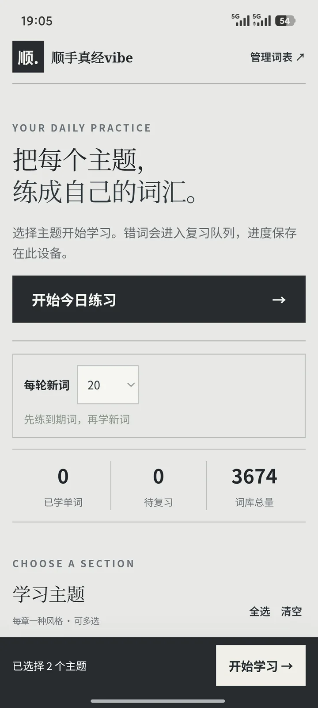
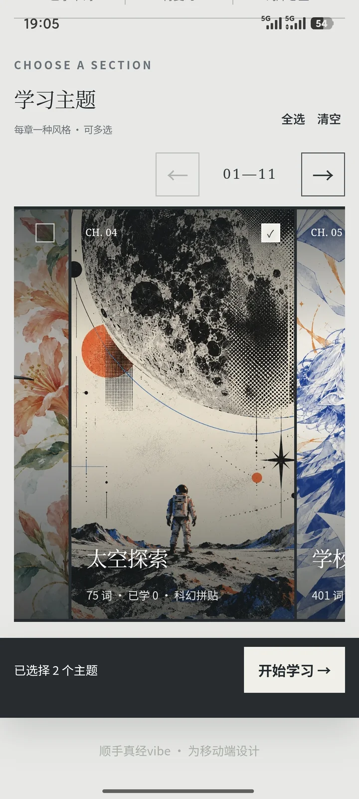
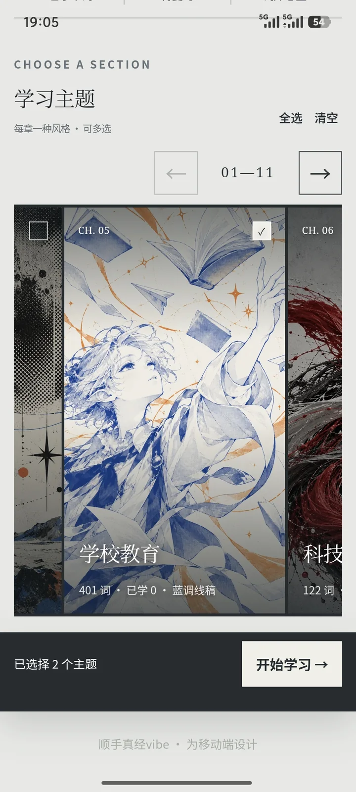
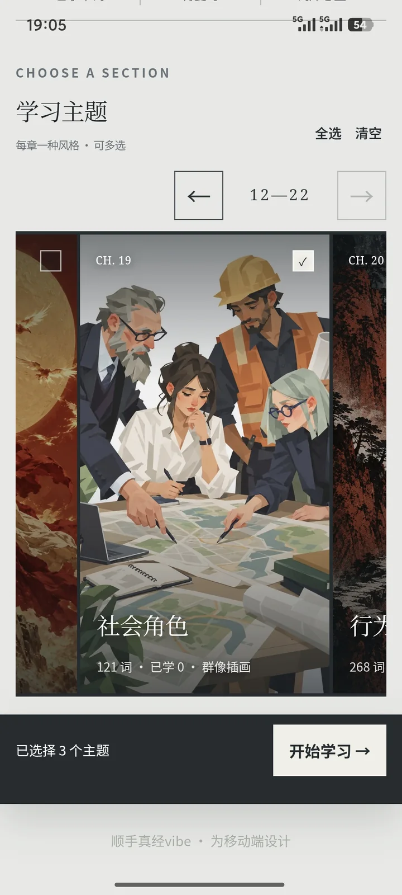
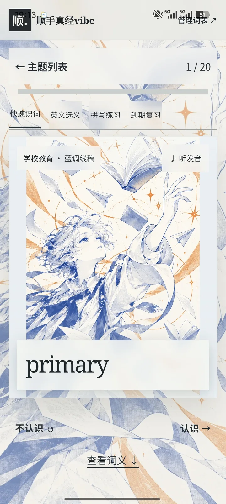

# 顺手真经vibe

一个基于《雅思词汇真经》22 章词汇做的背单词应用。每一章配一种画风，因为背单词本来就够无聊了，好歹好看点。

> 这本书的词汇表很不错，首推雅思使用，四六级也可以拿来当补充。
> 可记忆、可复习、可把已经熟的词去掉，也可以导入自己的词表。
> 电脑上能本地打开，安卓端有 APK。

作者：翌诩　当前版本：1.0.1

---

## 界面

| | | |
|:---:|:---:|:---:|
|  |  |  |
|  |  | |

---

## 二十二次不同的翻页

| | | |
|---|---|---|
| CH.01 自然地理 | CH.02 植物研究 | CH.03 动物保护 |
| CH.04 太空探索 | CH.05 学校教育 | CH.06 科技发明 |
| CH.07 文化历史 | CH.08 语言演化 | CH.09 娱乐运动 |
| CH.10 物品材料 | CH.11 时尚潮流 | CH.12 饮食健康 |
| CH.13 建筑场所 | CH.14 交通旅行 | CH.15 国家政府 |
| CH.16 社会经济 | CH.17 法律法规 | CH.18 沙场争锋 |
| CH.19 社会角色 | CH.20 行为动作 | CH.21 身心健康 |
| CH.22 时间日期 | | |

全书 3,674 个词，词性、释义、例句随表保留。每章一张插画、一套配色：残荷暮色、茶山水彩、蓝调网点、中式建筑纸雕、戏曲光影、雨夜电影肖像。翻到哪一章，单词卡片的底纹就跟着换。

界面是一张浅灰的纸，墨色的字，衬线标题、黑体正文，排得像一本杂志而不是一个 App。

## 四种练法

- **快速识词** —— 听发音、看单词，判「认识 / 不认识」，需要时展开词义例句
- **英文选义** —— 四选一，干扰项取自同一章，不会给你一眼就排除的选项
- **拼写练习** —— 只给释义，凭记忆敲出英文
- **到期复习** —— 只出该复习的词，按到期时间排序

标记「记住了」，这个词推到 1 天后；再对一次 3 天，然后 7 天、14 天、30 天。标记「还没记住」，一分钟后它会再回来一次。

已经熟的词可以「斩」掉，之后不再出现在新词、测试和复习里；斩错了在管理页能恢复。

## 下载与使用

**安卓**：[下载 APK](https://github.com/freefate258/shunshou-zhenjing-vibe/releases/latest)

传到手机，在文件管理器里点开安装。词库和 22 章插画都在安装包里，背词不需要联网。发音调系统语音；如果手机缺英语语音数据，可能要去系统设置里装一下英语语音包。

**网页版**：<https://freefate258.github.io/shunshou-zhenjing-vibe/>

手机浏览器打开后选「添加到主屏幕」，`sw.js` 会把资源全部缓存，加完就是离线能用的应用，不必装 APK。电脑上也可以用，或者把仓库里的 `dist/` 文件夹整个下载下来，双击 `index.html`。

**详细说明**：[文档/顺手真经vibe-软件介绍与使用说明.md](文档/顺手真经vibe-软件介绍与使用说明.md)

## 关于数据

学习进度只存在你这台设备上，不联网、无账号、没有统计后台。换手机之前，在「管理词表」里导出学习记录成 JSON，到新设备再导入。

导入自定义词表用 CSV，首行写：

```
module,word,meaning,phonetic,example
自然地理,atmosphere,大气层,,The atmosphere surrounds Earth.
```

最多 22 个主题。导入会替换当前词库并重置学习记录。注意：自定义词表的「图片对应」还不太对——插画是跟着章节序号走的，换了自己的词表以后图还是会按位置套上，这一点还没处理。

## 开发

这是一个 Capacitor 项目：网页部分在 `dist/`（构建产物）和 `src/`（源码），安卓壳在 `android/`。

```bash
npm install
npm run build:web    # 打包 native-tts.js
npm run android:sync # 同步进安卓工程
npm run android:debug # 出调试签名 APK
```

`assets/art-originals/`（91M 原画）和 `assets/art-references/`（32M 参考图）没有放进仓库，图源太大。需要改图的话另外找我。

## 词表来源

内置词表按《雅思词汇真经》2018 年版的 22 章目录整理，词性、释义、例句、搭配均随原书词表。代码是 MIT，词表内容版权归原书作者与出版社，这里只作个人学习用途，请勿商用转载。

## License

代码 MIT。作者：翌诩。
